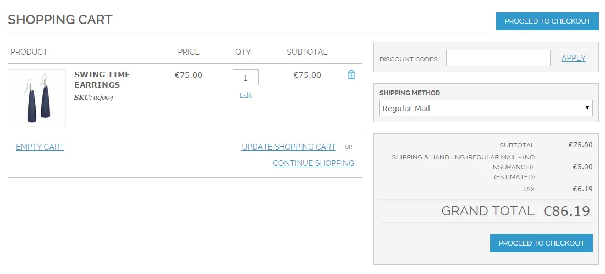
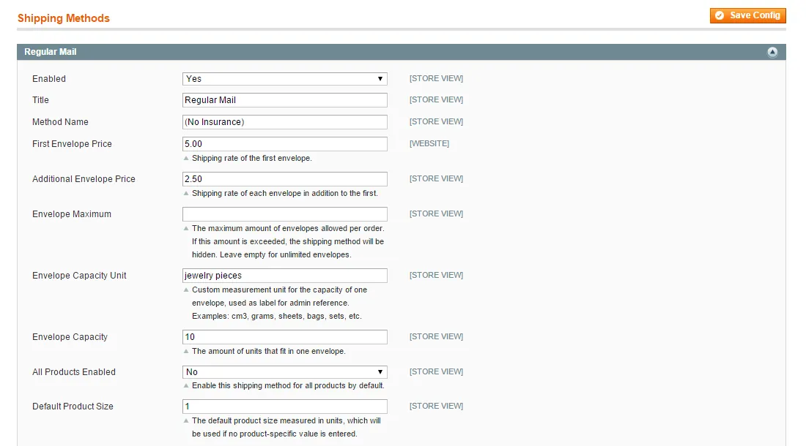
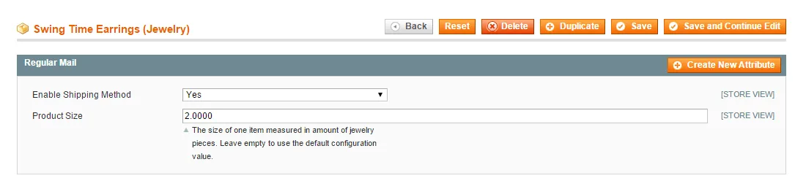

# Regular Mail Shipping for Magento 1 / OpenMage

**Shipping method for sending small items by regular mail in envelopes.**



Adds a shipping method for sending small or lightweight products by regular mail.

The number of envelopes per order is calculated from product sizes in a unit you define, with separate rates for the first and each additional envelope.

> [!NOTE]
> Regular Mail Shipping is free and open source under the MIT License (since 2026). Plugin Company no longer actively develops this extension, but issues and pull requests are welcome.

## Features

- Shipping method for envelope mail
- Rates for the first and each additional envelope
- Maximum number of envelopes per order
- Envelope capacity in a custom measurement unit
- Enable for all products or selected products only
- Product sizes in custom units
- Can be used as a 'no insurance' shipping method
- Compatible with Simple Shipping Estimate

## Screenshots

<table>
  <tr>
    <td width="50%" valign="top"><br><sub>Shipping method configuration screen</sub></td>
    <td width="50%" valign="top"><br><sub>Configure product size</sub></td>
  </tr>
</table>

## Compatibility

- **Magento:** Community Edition 1.4.x – 1.9.x, Enterprise Edition 1.8.x – 1.14.x
- **Latest version:** 1.0.0 (released 2015-07-27)
- **Composer package:** `plugincompany/magento1-regular-mail-shipping`
- **Module:** `Plugincompany_Regularmail`

## Installation

### modman

```bash
cd /path/to/magento
modman init   # once per Magento installation
modman clone https://github.com/PluginCompany/magento1-regular-mail-shipping.git
```

modman creates symlinks, so enable *Allow Symlinks* under System > Configuration > Advanced > Developer > Template Settings.

### Composer

With [magento-hackathon/magento-composer-installer](https://github.com/Cotya/magento-composer-installer) (it reads the `modman` file of this repository):

```bash
composer config repositories.plugin.company composer https://plugin.company/
composer require plugincompany/magento1-regular-mail-shipping
```

Your project `composer.json` needs the Magento root directory in its `extra` section (and, with Composer 2.2+, the installer plugin allowed), for example:

```json
{
    "extra": { "magento-root-dir": "./" },
    "config": { "allow-plugins": { "magento-hackathon/magento-composer-installer": true } }
}
```

### Manual installation

Download the ZIP of the latest release from the [tags page](https://github.com/PluginCompany/magento1-regular-mail-shipping/tags) ([1.0.0](https://github.com/PluginCompany/magento1-regular-mail-shipping/archive/refs/tags/1.0.0.zip)) and copy the `app/` folder into your Magento root:

```bash
unzip magento1-regular-mail-shipping-1.0.0.zip
cp -R magento1-regular-mail-shipping-1.0.0/app /path/to/magento/
```

Step-by-step instructions are in the [installation guide](docs/02-installing-the-magento-extension.md).

### After installing

Clear the cache (System > Cache Management, or `rm -rf var/cache/*`), then log out of the admin and log in again so the new configuration sections and permissions are loaded.

## Documentation

- [Documentation in this repository](docs/README.md) (Installation Guide, User Manual)
- Online documentation: <https://plugin.company/knowledge-base/docs/magento-regular-mail-shipping/>
- Product page: <https://plugin.company/magento1-extensions/regular-mail-shipping.html>

## Changelog

See [CHANGELOG.md](CHANGELOG.md) for the release history.

## Contributing

Found a bug or have an improvement? Please open an [issue](https://github.com/PluginCompany/magento1-regular-mail-shipping/issues) or send a [pull request](https://github.com/PluginCompany/magento1-regular-mail-shipping/pulls). Since the extension is no longer actively developed by Plugin Company, fixes from the community are the best way to keep it working on current Magento 1 / OpenMage and PHP versions.

## License

Plugin Company's code in this repository is released under the [MIT License](LICENSE), Copyright (c) 2014-2026 Plugin Company.

No third-party libraries are bundled; see [THIRD-PARTY-NOTICES.md](THIRD-PARTY-NOTICES.md).
