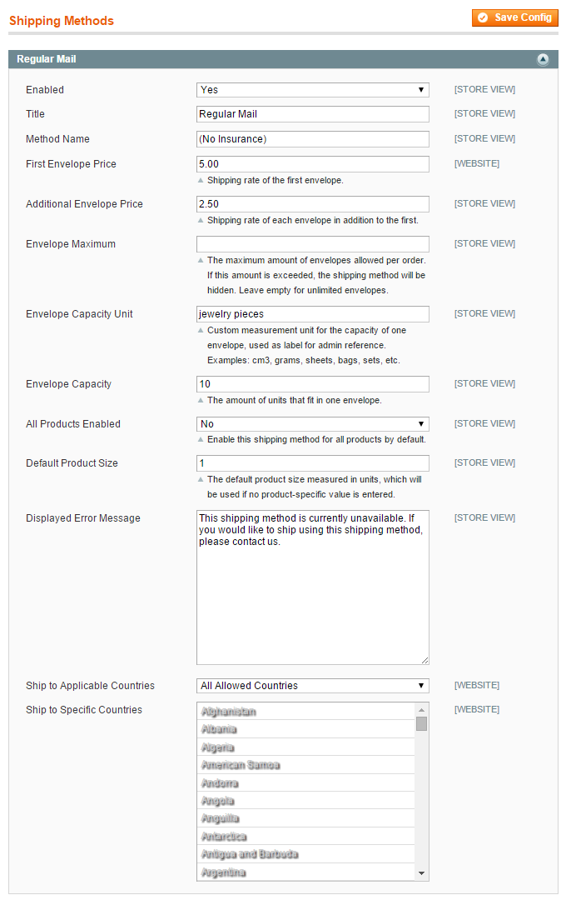

# Configuring the Regular Mail Shipping Extension

To configure the extension's general and default shipping rate settings, navigate to **System > Configuration** in the top Admin Panel menu and select **Shipping Methods** from the left side menu.

Using the Regular Mail section you can:

- Enable the extension to use the shipping method in the Admin Panel and front-end store.
- Modify the shipping method title and name which are shown in the shopping cart.
- Configure the envelope shipping rate s, capacity and the default product size measured in custom capacity units as further explained below.
- Modify the displayed error message if the shipping method is unavailable.
- Choose to enable the shipping method for all allowed countries or specific countries only using the 'Ship to Applicable Countries' option.
- If applicable, select the allowed destination countries for the shipping method at 'Ship to Specific Countries'.
- If specific countries are selected, you can choose to show or hide the shipping method for not applicable countries.
- When multiple shipping methods are enabled, you can define the sort order, starting with 0.

It's possible to configure the shipping method per store view by changing the 'Current Configuration Scope' at the top left corner of the page.

To save any changes made in the Regular Mail settings, click the 'Save Config' button in the top right corner of the configuration page.

## First and Additional Envelope Price

You can enter a shipping rate per envelope at 'First Envelope Price'.

If you want to charge a different shipping rate for each envelope in addition to the first, you can enter this at 'Additional Envelope Price'.

## Envelope Maximum

At 'Envelope Maximum' you can optionally set a maximum amount of envelopes per order, for example in case a different shipping method should be selected for larger shipments.

When the envelope maximum is exceeded, the Regular Mail shipping method will be automatically hidden from the shopping cart.

## Envelope Capacity Unit

In order to calculate the amount of items that fit in one envelope, you can enter a custom measurement unit at 'Envelope Capacity Unit', for example: cm³, grams, sheets, pieces, sets, etc.

## Envelope Capacity

At 'Envelope Capacity' you need to enter the *amount* of capacity units that fit in one envelope, for example: 100 [sheets of paper], 10 [jewelry pieces] or 250 [grams].

The capacity unit will shown as a label for admin reference in the [Regular Mail tab](./05-configuring-the-regular-mail-settings-per-product.md) of the product view, where you need to enter a product size measured in amount of envelope capacity units.

## All Products Enabled

To enable the Regular Mail shipping method for all products by default, select 'Yes' at 'All Products Enabled'.

Alternatively, you can also enable or disable the shipping method for each product separately in the [Regular Mail tab](./05-configuring-the-regular-mail-settings-per-product.md) of the product view.

## Default Product Size

You can enter a default product size measured in envelope capacity units, which will be used no product specific value has been entered in the [Regular Mail tab](./05-configuring-the-regular-mail-settings-per-product.md) of the product view.

---

[Documentation index](./README.md) · [README](../README.md) · [Online version](https://plugin.company/knowledge-base/docs/magento-regular-mail-shipping/user-manual/configuring-the-regular-mail-shipping-extension/)
