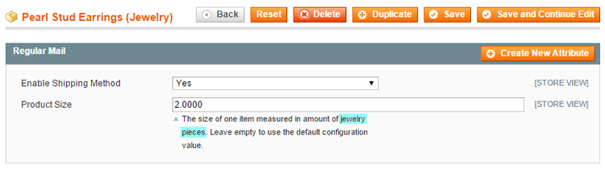

# Configuring the Regular Mail Settings Per Product

The configure the Regular Mail settings per product, navigate to **Catalog > Manage Products,** select a product from the list and click **Regular Mail** in the left side menu.

Using the Regular Mail tab in the product view you can enable the shipping method for a specific product and enter the product size of one item measured in amount of envelope capacity units.

For example, if the capacity of one envelope is set to 10 jewelry pieces, the size of one pair of earrings measured in capacity units could be 2. Accordingly, a maximum of 5 pairs of earrings will be shipped in one envelope.

If a custom capacity unit is entered on the [Shipping Methods config page](./04-configuring-the-regular-mail-shipping-extension.md) it will be shown in the description under the 'Product Size' input field.

If Regular Mail Shipping is enabled for a specific product and the 'Product Size' field is left empty, the default product size configured on the [Shipping Methods config page](./04-configuring-the-regular-mail-shipping-extension.md) will be used.

---

[Documentation index](./README.md) · [README](../README.md) · [Online version](https://plugin.company/knowledge-base/docs/magento-regular-mail-shipping/user-manual/configuring-the-regular-mail-settings-per-product/)
